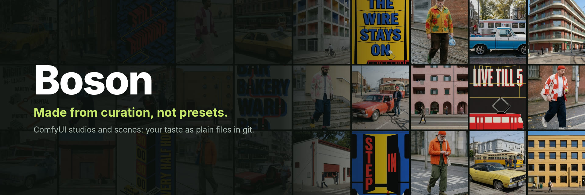
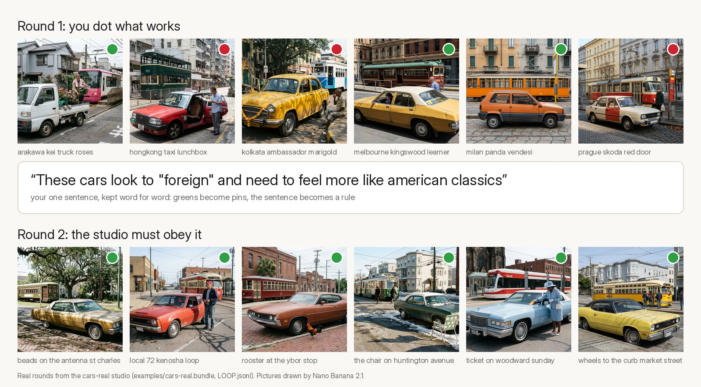
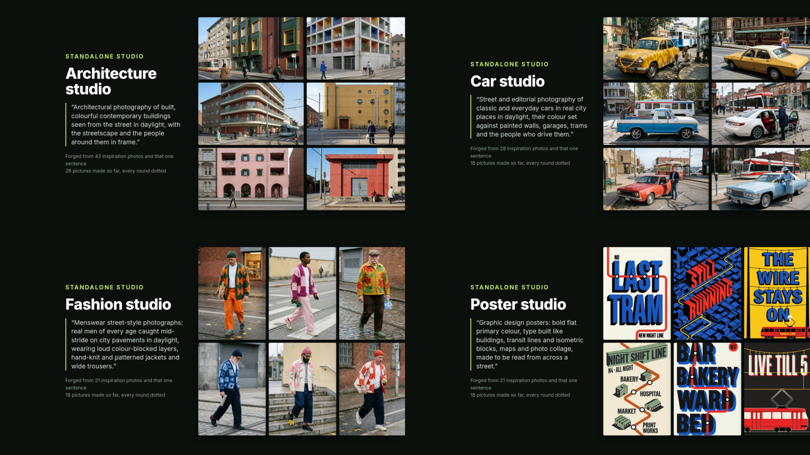
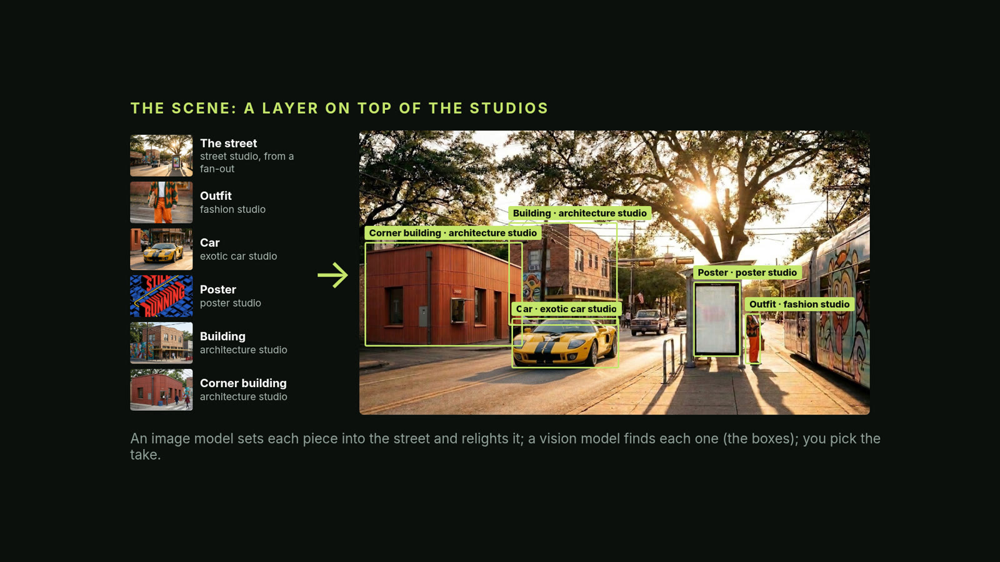
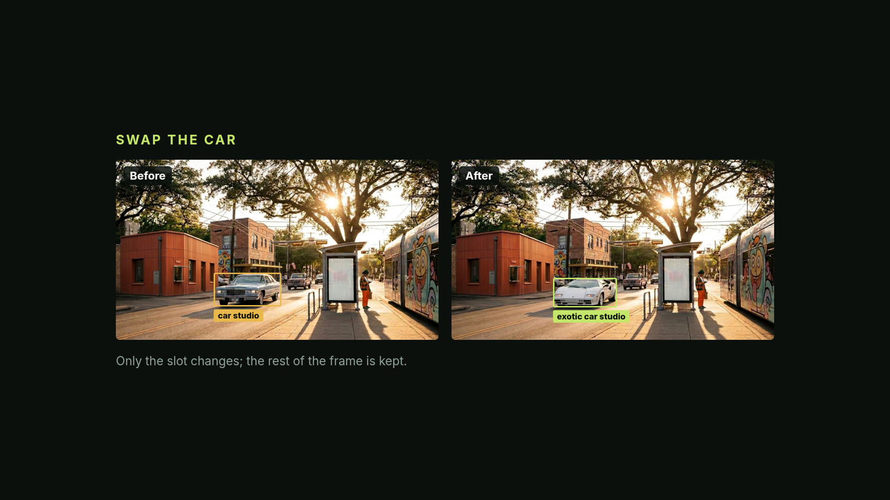
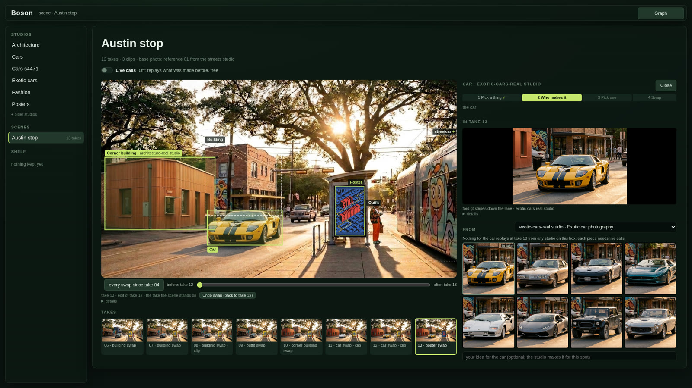
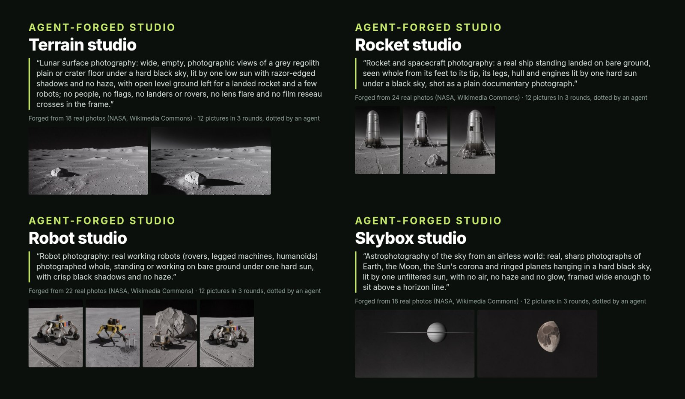
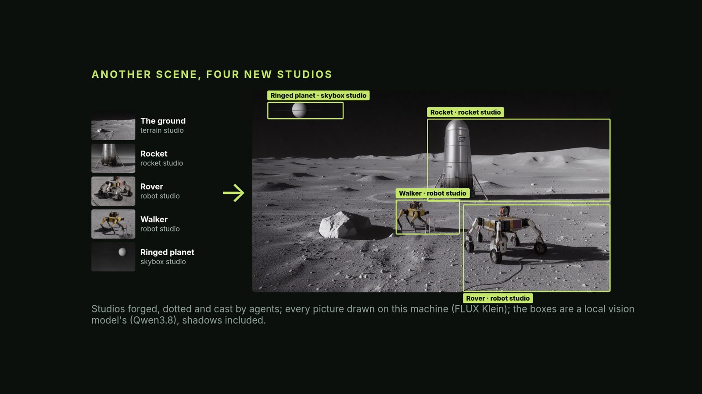

# Boson



**A style reference gives you a look. Boson gives it a history.**

Boson is a set of ComfyUI nodes for making images and clips with *your* taste, kept as plain files in git.
It has no taste of its own. You dot what works (green, red), write one sentence, and that verdict becomes a rule
every next round must read. The studio remembers, in files you can read, edit, branch and share.



An entry to Comfy's Open Source Higgsfield challenge (2026), in the Most Innovative category. Built over 13 days
(2026-10-17 to 10-29): more than 500 commits and 56 recorded decision rounds. This repo's own history is condensed to
a few builds to keep the author's working files private; each studio and scene in `examples/*.bundle` keeps its full
round-by-round history. What is new is the idea as a whole, in five parts:

1. **Studios instead of presets.** A studio is a folder of plain files in git that holds one taste, for one field
   (architecture, cars, fashion, posters): `STUDIO.md` (its idea, idiom and refusals), `TASTE.json` (words, style
   lines, pinned pictures), `LOOP.jsonl` (every round and your verdict on it). Forged from your reference pictures
   and one sentence.
2. **The curation loop.** Make a round, dot it red and green, write one sentence. That verdict becomes a rule the next
   round must read: greens become pins, the sentence is appended word for word under "From your verdicts". All
   committed, so the taste builds up with a history.
3. **The scene editor.** A street, a moon landing, any picture, where every piece is a **slot** (a box on the picture that can be refilled: an
   outfit, a car, a poster, a building) any studio can fill. Click a slot and pick **any** studio: it makes its own
   versions for that exact spot (from a crop of the frame, so they already sit in its place and light), and a Swap
   redraws and relights only what changed. Even background things that came with the street, like the corner
   taqueria, can become slots. Then set the frame in motion. Every take and clip is a commit.
4. **The engineering underneath.** Ordinary ComfyUI graphs that pause for your judgment, replays that cost nothing,
   and any model behind one switch.
5. **Models for their strengths, open by design.** Every part sits behind one switch, so Boson runs fully local on
   open weights, all cloud, or a hybrid, each model on the task it does best, and your feedback chooses. The demo's
   studios and scene were made with the cloud models; only clips, an optional last step, still need one. Next on the roadmap: a fan-out test of each model on each task, with your dots picking the model.

## In pictures

Four studios, each forged from reference photos and one sentence, each with its own taste and its own history:



The scene editor: a street where every piece is a slot that any studio can fill, made for that exact spot:



A swap redraws only the slot; the rest of the frame is kept:



It all runs as an app inside ComfyUI (`/boson/app`), here on a fresh clone with no network and no keys:



Streets are one case. The same studios and slots make any scene. This one had no human in any seat (2026-10-29):
four agents each gathered real NASA and Wikimedia Commons photos, forged a studio from them (terrain, rockets, robots,
the sky), and ran three rounds, dotting and judging their own pictures. Then one more agent built the scene and cast
its slots. Every picture was drawn on one RTX 4090 by FLUX 3 Klein, and the boxes were found by Qwen3.8 on the same card:





The agents' dots and verdicts are their own judgments, not the author's taste. The words behind it (each studio's
text, the descriptions of the photos) came from cloud models: Claude and Gemini.

## See it in two minutes (no keys, no account)

Everything in this repo was already rendered, so you can browse it without a single API call.

You need: [ComfyUI](https://github.com/comfyanonymous/ComfyUI) installed (a recent release; tested on 0.42 with
frontend 1.57), and `git` on your PATH. No GPU, no network and no key needed for viewing.

```bash
git clone https://github.com/0xMisterBailey/Boson
cd /path/to/ComfyUI/custom_nodes
ln -s /path/to/Boson/boson boson          # a symlink, not a copy: the nodes find examples/ beside it
cd .. && python main.py                   # add --cpu on a machine without a GPU
```

Open **http://127.0.0.1:8188/boson/app**. The left rail lists the studios and the scenes. The first open of a studio
or a scene takes a few seconds: it is cloned from its bundle in `examples/`.

To replay a Swap (not only look at the takes), ComfyUI also needs BiRefNet, the subject-mask model, which a stock
ComfyUI does not have (444 MB, the one download). The scene's graph names it, so without it browsing works but ComfyUI
refuses a Swap before it starts ("press Graph to see which node it names").

```bash
cd /path/to/ComfyUI/models && mkdir -p background_removal && cd background_removal
curl -LO https://huggingface.co/Comfy-Org/BiRefNet/resolve/main/background_removal/birefnet.safetensors
```

Restart ComfyUI after adding it. On a machine without a GPU (`--cpu`), car, poster and building swaps replay; the
outfit swap's replay runs (about 40 s) but makes no take yet: BiRefNet's masks on a CPU differ by a hair from the
ones the outfit was made with, so its stored boxes don't match (2026-10-27).

Your name on saves (optional): every click that changes a studio or the scene (Undo, Cast, Swap, a dot) is saved as a
git commit in a working copy under `~/.cache/boson` (`$BOSON_HOME` moves it); nothing leaves your machine. If git has
no name and email set, Boson signs those commits "Boson". To sign them yourself:
`git config --global user.name "Your Name"` and `git config --global user.email "you@example.com"`.

- Click **Architecture** (or Cars, Fashion, Posters): the studio's house, its rounds, each verdict beside what it
  changed and what the next round made.
- Click **Austin stop**: the scene, its takes, which studio filled which slot, and its clips. Click a box on the
  picture: its studio, a picker for any other studio, their pieces. With "live calls" off, Make and Swap only replay
  what was made (no key); take 08 -> 12 is the outfit, the taqueria made a slot, and a car from a second car studio.
- Click **Airless landing**: the sci-fi scene, its four slots (rocket, rover, walker, ringed planet) and the four
  agent-forged studios that filled them (terrain, rockets, robots, skybox), each with its three dotted rounds.
- **Graph** (top right) shows the real ComfyUI graph under every screen; every button sets widgets on real nodes.

Workflows in `workflows/` open in ComfyUI directly (Workflow > Open). They start in `stored` mode: they replay what
was made, with no key and no call.

## Make new things (your machine or the cloud, one switch)

Switch a node from `stored` to `live`. Every part runs either on your own machine, with open-weights models, or on a
cloud model with a key, through the same switch. A studio never names a model, so you can change the backend without
touching it. "Open weights" means the model itself is published and runs anywhere, your machine or a rented one.

**On your own machine (open weights, no keys):**

- **Pictures:** `backend: local` draws with FLUX 3 Klein on a ComfyUI you name in `BOSON_LOCAL_COMFY` (default
  `http://127.0.0.1:8188`). That has to be a second ComfyUI (another port), or a run from the command line
  (`tools/loop.py --backend local`, `tools/scene_local.py`): a Make inside the ComfyUI it would queue onto is refused,
  because it would wait on itself.
- **Writing studios and briefs:** the same `claude -p`, pointed at an open model (we use Qwen3.8 27B) behind an
  Anthropic-compatible gateway: `BOSON_WRITER_BASE_URL` (the gateway's URL, not a raw llama-server port) and
  `BOSON_WRITER` (the model name it serves). A local writer gets no login and no background traffic.
- **Finding things in a frame** (Locate): a vision model on a llama-server with its projector, at
  `BOSON_LOCATE_BASE_URL` (default `http://127.0.0.1:8192`). Set the Locate node's `model` to `local:NAME`.
- **Subject masks:** BiRefNet, as shipped with ComfyUI. `BOSON_SEG_DEVICE=cpu` keeps it off a full card.
- **One 24 GB card:** the writer, Klein and the vision model do not fit at once. They take turns on the card.
- **Motion:** no local video model yet. Clips still need a cloud model (below).

Measured on one RTX 4090 (2026-10-27): a studio round written by Qwen3.8 and drawn by Klein took ~17 min (the cloud
path: ~2.5 min); a scene's shoot, car swap and outfit swap took ~7 min. Both cost $0, and a trace showed only
connections to the machine itself. The studio and the street they started from had been made earlier in the cloud.

**The same switch, in the cloud (keys):**

- **Pictures:** Nano Banana 2.1, on your Comfy credits (`backend: comfy-api`; a Comfy API key from platform.comfy.org
  in `COMFY_API_KEY`), a Gemini API key (`backend: api`; `GEMINI_API_KEY`), or a signed-in Antigravity plan
  (`backend: antigravity`, ~1K). The widget's default is `api`.
- **Writing:** Claude, through `claude -p` (signed in). `BOSON_WRITER` picks the model; the default is
  `claude-opus-5-5`.
- **Locate:** Gemini vision (`gemini-3.8-flash`, the node's default), `GEMINI_API_KEY`.
- **Motion:** Comfy's partner video nodes (LTX 2.5 Pro, Gemini Omni Flash 1.1) on Comfy credits (ComfyUI's sign-in).

Measured cloud costs (2026-10): a make of 4 pictures is about $0.30 of images plus $0.75-1.25 of writing; a scene
swap about $0.06; a 6 s 1080p clip $1.31 (Omni Flash) to $1.46 (LTX 2.5 Pro).

## Models used

Open weights (published, run anywhere): **FLUX 3 Klein** (pictures), **Qwen3.8 27B** (writer and Locate, with its
vision projector), **BiRefNet** (subject masks). Closed (reached only through a service): **Nano Banana 2.1**
(`gemini-nano-banana-2.1`, pictures, via Comfy's API and Google's), **Claude Opus 5.5** (writer, via `claude -p`),
**Gemini 3.8 Flash** (Locate), **LTX 2.5 Pro** and **Gemini Omni Flash 1.1** (clips, via Comfy's partner nodes).
Boson's own code is open source either way.

How the shipped work was made: the studios (architecture, cars, exotic cars, fashion, posters) and the Austin scene
were made with Nano Banana pictures, Claude-written words, the author's red and green dots, and Gemini boxes (Locate).
The airless landing and its four studios (terrain, rockets, robots, skybox) were made with Klein pictures and Qwen3.8
boxes on one RTX 4090, Claude-written words, Gemini descriptions of the reference photos, and agents' dots.
The app names the model that drew each take it knows of. The local path (Klein, Qwen3.8, BiRefNet) exists and has
run: one studio round and one scene's shoot and two swaps, on 2026-10-27 (above). The code's defaults are the cloud
ones: `backend: api`, the Opus writer, Gemini Locate.

One side-by-side test (2026-10-28): the same Austin scene from the same prompts, drawn three ways: A all cloud (Nano Banana), B all on this machine (FLUX 3 Klein), C the cloud street with Klein drawing the takes. The author judged A and C equal on 11 of 12 takes (A better on the other, where C changed the wrong building) and B worse, for its framing, not its detail. On the 39 pieces: A 18, tie 19, B 2. The shipped scene is A.

## What's in the repo

- `boson/`: the node pack (studio, loop, scene nodes) and the app (`boson/web`), served at `/boson/app`.
- `examples/*.bundle`: the studios and the two scenes (Austin stop, airless landing) as git bundles (full history). `examples/*-plates/`: the
  pictures their rounds rendered, with manifests naming the prompt and studio commit behind each.
- `workflows/`: ready graphs (studio, scene, motion, the in-context building rework).
- `tools/`: command-line versions of the same steps (`loop.py`, `seed.py`, `motion_workflow.py`, `ship.py`).
- `docs/`: the app's contract (`APP-API.md`), how to forge a studio from real references (`REAL-REFS.md`,
  `FORGE.md`), and the two-page paper (`docs/whitepapers/higgsfield-ported.pdf`).

## Honest limits

- Boson keeps taste; it does not have any. A round you only praise gives the next round nothing to bind.
- A loop that binds every verdict can narrow toward your own average. The way out is a branch: fork the studio from
  an earlier round, or start a sibling from fresh references.
- Real reference photos are not in this repo. The real-reference studios list each one's source in
  `refs/refs.jsonl`; their files stayed on the author's machine. Every picture in `examples/` is AI-generated.
- Making new rounds needs either a GPU for the local path (one 24 GB card; slower than the cloud) or paid model
  access. Clips need a cloud model either way.

## Licence

MIT (see `LICENSE`). ComfyUI and the models above have their own licences and terms.
