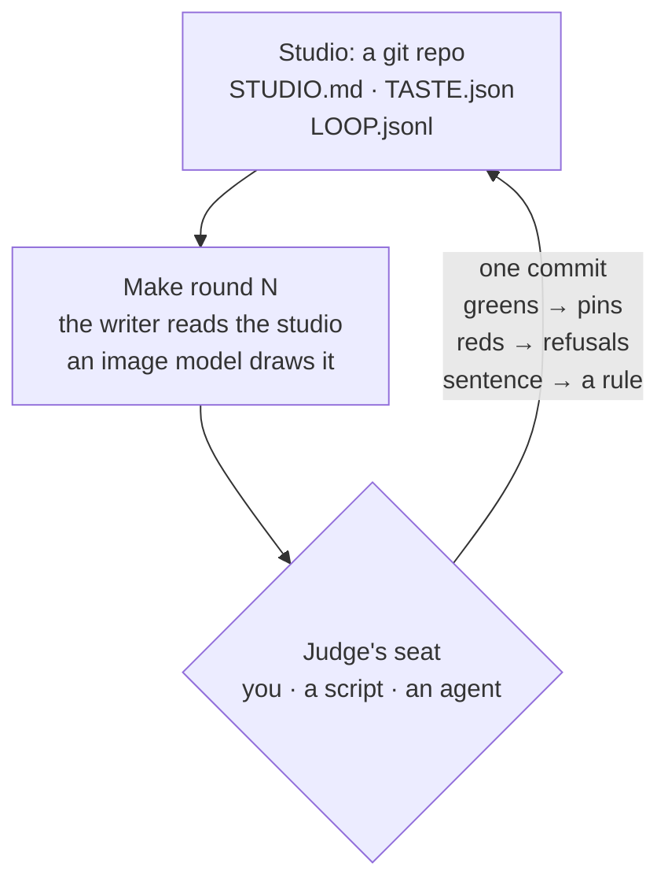
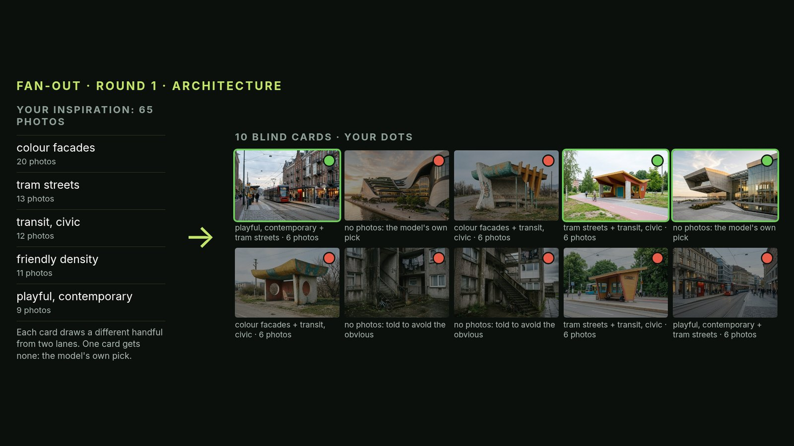
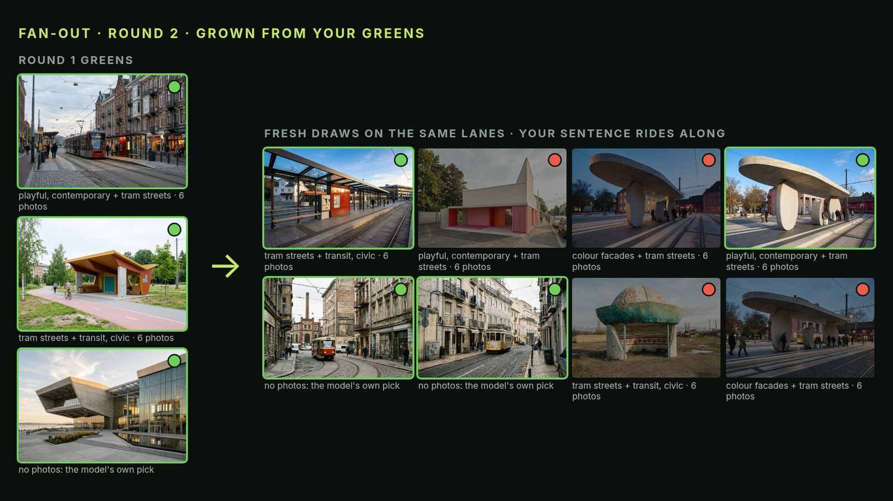
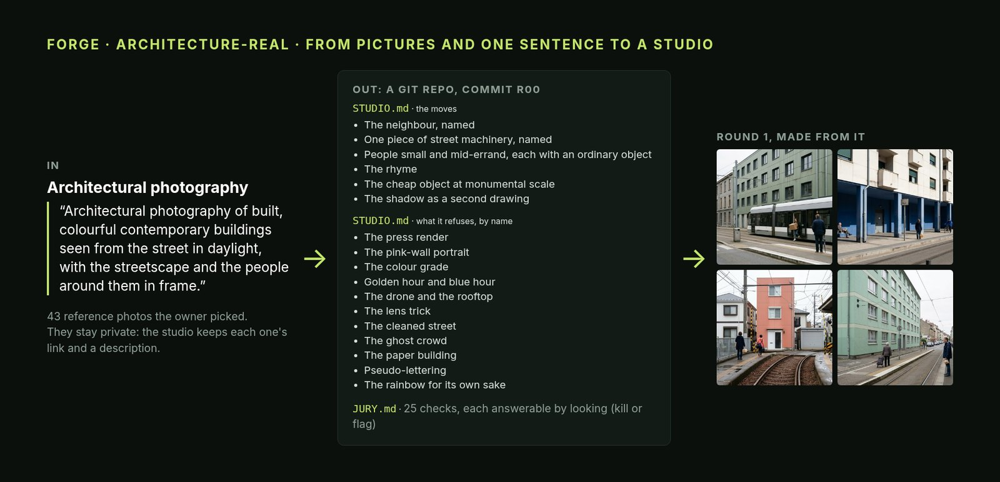
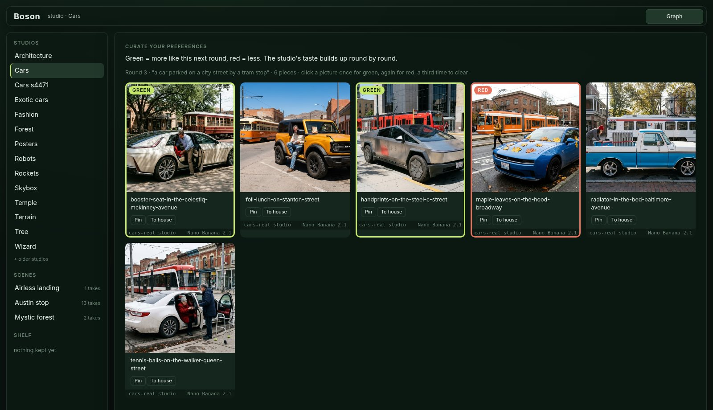
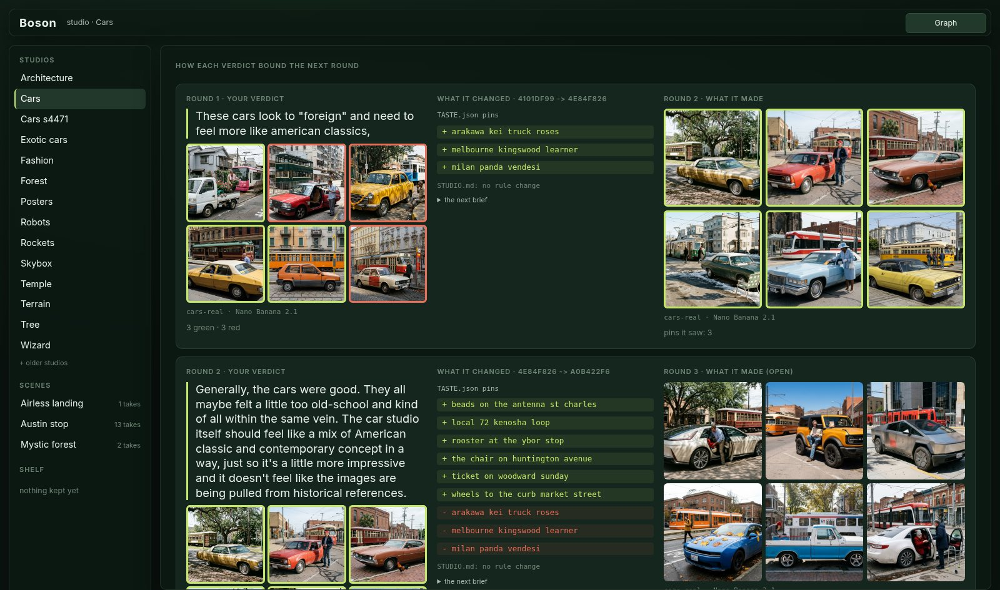
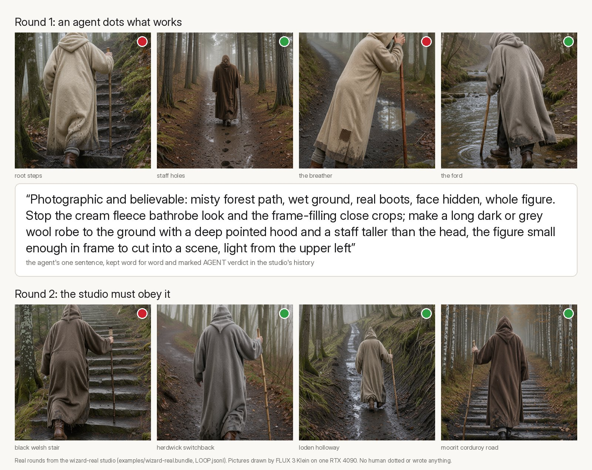

# Boson


> **Studios instead of presets: your taste as plain files in git that every next ComfyUI round obeys.**

Boson is a ComfyUI node pack, and an app served by the same ComfyUI, built around one feedback loop: make a round,
judge it (green and red dots, one sentence), and the judgment becomes state the next round must read. That state is
a git repo, a **studio**: plain files you can read, diff, branch and share. Boson has no taste of its own. Whoever sits
in the judge's seat supplies it: you in the app, or a script or an AI agent from the command line.


- **28 nodes and an app** (`/boson/app`) on plain ComfyUI. No Python packages beyond ComfyUI's own; `git` on `PATH`.
- **Every past step replays for free.** Nodes run `stored` (replay what was made: no key, no network) or `live`.
- **One switch per capability.** Fully local on open weights, all cloud, or a hybrid; a studio never names a model.
- **Ships with 15 studios and 3 scenes**, each a git bundle with its full round-by-round history. Two of the scenes,
  and the eight studios behind them, were made end to end by agents, with no human in any seat.

An entry to Comfy's Open Source Higgsfield challenge (2026), in the Most Innovative category. Built over 13 days
(2026-10-17 to 10-29): more than 500 commits and 56 recorded decision rounds. This repo's own history is condensed to
a few builds to keep the author's working files private; each studio and scene in `examples/*.bundle` keeps its full
history.

**Contents:** [Install](#install) · [The feedback loop](#the-feedback-loop) ·
[A studio, from nothing to running](#a-studio-from-nothing-to-running) · [Scenes](#scenes) · [What is new](#what-is-new) ·
[How it works](#how-it-works) · [Three ways to run it](#three-ways-to-run-it) ·
[Models: one switch](#models-one-switch-per-capability) · [What ships](#what-ships) ·
[Repository layout](#repository-layout) · [Honest limits](#honest-limits)

## Install

Viewing everything that ships needs no GPU, no key and no network after the clone.

**Requirements:** [ComfyUI](https://github.com/comfyanonymous/ComfyUI) (tested on 0.42 with frontend 1.57, on Linux;
macOS and Windows are untested) and `git` on your `PATH`. The clone is about 325 MB to download (the studios'
pictures and histories).

```bash
cd /path/to/ComfyUI/custom_nodes
git clone https://github.com/0xMisterBailey/Boson
cd .. && python main.py                   # add --cpu on a machine without a GPU
```

Open **http://127.0.0.1:8188/boson/app**. The left rail lists the studios and the scenes; the first open of each
takes a few seconds (it is cloned from its bundle in `examples/`). Any folder name works, and so does a clone kept
elsewhere with a link to it in `custom_nodes/`.

**Optional, to replay a Swap** (not only look at the takes): ComfyUI also needs BiRefNet, the subject-mask model (444
MB). Without it browsing works, and ComfyUI refuses a Swap before it starts, naming the missing node.

```bash
cd /path/to/ComfyUI/models && mkdir -p background_removal && cd background_removal
curl -LO https://huggingface.co/Comfy-Org/BiRefNet/resolve/main/background_removal/birefnet.safetensors
```

On a CPU-only machine, car, poster and building swaps replay; the outfit swap's replay runs (about 40 s) but makes no
take, because BiRefNet's masks on a CPU differ by a hair from the ones the outfit was made with.

**Where your work goes:** every click that changes a studio or a scene (a dot, Undo, Cast, Swap) is a git commit in a
working copy under `~/.cache/boson` (`BOSON_HOME` moves it). Nothing leaves your machine unless you switch a node to
`live`. If git has no name and email set, Boson signs those commits "Boson".

To make new pictures, see [Models](#models-one-switch-per-capability) and [docs/CONFIG.md](docs/CONFIG.md).

## The feedback loop



1. **Make.** The writer (an LLM) reads the whole studio, its practice, its pins and every verdict so far, and writes
   *n* render specs for your idea. The image model draws them with the studio's references.
2. **Judge.** Dot each picture green (more like this) or red (not this), and write one sentence on the round as a
   whole. A verdict alone, or dots alone, never go on: the graph waits.
3. **Commit.** Greens join the studio's pins in `TASTE.json`; reds leave them. The sentence is appended verbatim to
   `STUDIO.md` under "From your verdicts", where it binds every later make. The round, its dots and its verdict are a
   row in `LOOP.jsonl`. One commit, and the same verdict again commits nothing.
4. **Next.** The next make reads all of it: the verdict in quotes, the greens as pinned pictures (on the local
   backend, two of the studio's own reference photos instead), the reds named as "not like these".

A judged round cannot be judged again on the same branch. To change your mind, branch the studio from an earlier
round, as you would branch code.

## A studio, from nothing to running

Every picture below is real Boson output, with the dots and sentences that were really given (except the app grid
in step 4, dotted for the screenshot and never submitted). Steps 3 to 5 are studios that ship in `examples/`; the
ignition rounds in steps 1 and 2 were a separate architecture run and do not ship.

### 1. Ignition: no references yet (optional)

`tools/ignite.py FIELD run` makes one blind round on a plain brief. Some cards are the image model's own default for
the field, some are the writer's attempt to dodge that default, and the rest each draw a handful of photos from two
"lanes" of an inspiration pool (photos gathered for the field, by you or by agents). The cards are shuffled and
unlabelled, so a lane's name cannot sway a dot. `dots` opens the grid, and `read` reveals which card was which.



### 2. Fan-out: grow from the greens

`ignite.py FIELD fan` grows the next blind round from the last one's greens: fresh draws on the lanes that won,
untried lane pairs for the rest, and the model's default kept as a control. Every verdict so far rides word for word
on every prompt. Fan until you like what you see, then forge from those greens.



### 3. Forge: pictures and one sentence become a studio

`tools/loop.py NAME forge --field "..." --sentence "..."` describes each reference photo (one vision call each), then
the writer reads those descriptions and writes the studio: its moves, what it refuses by name, and a jury of checks a
picture must pass by looking. The photos stay private; the studio keeps each one's link and description. That first
commit is tagged `r00`, and round 1 is drawn from it.



### 4. Running it: you in the judge's seat

In the app, the open round is a grid: click once for green, again for red, then write one sentence. Submit queues
the Dots node, which makes one commit and no model call.



Below the grid, the studio shows its own history. Each verdict sits beside what it changed (the pins added and
removed in `TASTE.json`, any rule in `STUDIO.md`) and the round it produced.



### 5. Or an agent in the judge's seat

The same loop from the command line, `loop.py NAME dot --green ... --red ... --verdict "..."`, lets a script or an
AI agent judge the round. The wizard studio below was gathered, forged and judged by an agent. Its verdict is
stored word for word and marked `AGENT verdict`, so a studio's history always says who judged it.



## Scenes

A scene is a picture whose pieces are **slots**, and each slot is filled by a studio. The studios keep the taste; the
scene keeps the composition. Swapping a piece redraws and relights only that slot, and every take is a commit.


The same pattern built two scenes with no human in any seat, from eight agent-forged studios drawn on one RTX 4090:


## What is new

The idea as a whole, in five parts:

1. **Studios instead of presets.** A studio is a folder of plain files in git that holds one taste, for one field
   (architecture, cars, fashion, posters): `STUDIO.md` (its idea, idiom and refusals), `TASTE.json` (pinned
   pictures), `LOOP.jsonl` (every round and the verdict on it). Forged from reference pictures and one sentence.
2. **The curation loop.** Above: a verdict becomes a rule the next round must read, committed, so the taste builds up
   with a history you can read, branch and share.
3. **The scene editor.** A street, a moon landing, a misty forest, any picture, where every piece is a **slot** (a
   box on the picture that can be refilled: an outfit, a car, a poster, a building) any studio can fill. A studio
   makes its own versions for that exact spot, from a crop of the frame, so they already sit in its place and light;
   a Swap redraws and relights only what changed. Background things, like the corner taqueria, can become slots.
   Every take and clip is a commit.
4. **The engineering underneath.** Ordinary ComfyUI graphs that pause for your judgment, replays that cost nothing,
   and any model behind one switch.
5. **Models for their strengths, open by design.** Every part sits behind one switch, so Boson runs fully local on
   open weights, all cloud, or a hybrid, each model on the task it does best. The demo's studios and the Austin scene
   were made with the cloud models; only clips, an optional last step, still need one. Next on the roadmap: a
   fan-out test of each model on each task, with your dots picking the model.

## How it works

### A studio is a git repo

```text
architecture-real/
├── STUDIO.md            the practice: idea, idiom, refusals; "From your verdicts" holds every verdict, verbatim
├── TASTE.json           the house: its pins (studio@sha:path), and any words, style lines or pictures the owner set
├── LOOP.jsonl           one row per round (idea, pieces, studio commit) and one per verdict (greens, reds, sentence)
├── JURY.md              checks a picture must pass, each answerable by looking (kill / flag)
├── RENDER.json          how its pictures are drawn: aspect, size, references, the instrument's prompt rules
├── instruments.yaml     what each picture model can and cannot do, for the writer
├── FORGE-INPUT.md       what it was forged from: the owner, the field, the one sentence
├── history/             rounds.jsonl, RULES.md (rules the owner approved), LESSONS.md
└── refs/refs.jsonl      each reference: its source url and its description (the pictures stay private)
```

The forge is tagged `r00`; every round records the studio commit it was made from, and pieces are addressed as
`studio@sha:path`. Every node that changes a studio commits, so any round can be loaded at its commit, diffed or
branched. Pictures live beside the repo (`NAME-plates/`), with manifests and logs naming each one's prompt, model and
studio commit.

### A scene is a git repo

```text
mystic-forest/
├── SCENE.json           the base view, the slots (what each is, which studio fills it), the take it stands on
└── takes/NN/            image.jpg, cast.json (which piece in which slot), boxes.json (where each slot is), take.json
```

A swap runs as one ComfyUI graph: **Compile Scene** (the shot: the take, the cast pieces, a deterministic prompt) →
the image model → **Uncrop** (a close-crop edit goes back in through its subject mask only, so the crop's own
background never shows) → **Locate** (a vision model boxes every slot in the new take) → **Commit Take**. Flat pieces
(posters, signs) are perspective-warped onto the quads Locate found (**Paste Flat**). A slot's Make is commissioned
from **Slot Crop**, a crop of the current take, which is why its pieces arrive in place and in light.

### Stored and live

Make, Nano Banana and Locate have a `mode`: `live` calls the model once and stores the result under a key made from
its inputs; `stored` replays that result and never calls anything. Shipped workflows open in `stored` mode, which is
why the whole repo replays with no key. Re-queuing a node that already ran commits nothing.

### The app is the graph

`/boson/app` is a page served by the pack (`boson/server.py`, read-only routes plus two one-commit writes). Every
button sets widgets on real Boson nodes in the loaded ComfyUI graph and queues it; **Graph** (top right) shows that
graph. The contract between the page and the nodes is [docs/APP-API.md](docs/APP-API.md).

## Three ways to run it

1. **The app**, `/boson/app`: studios, rounds, dots, scenes, slots, swaps and clips, for a person with a mouse. A
   walkthrough of everything that ships: [docs/TOUR.md](docs/TOUR.md).
2. **ComfyUI graphs.** The workflows in `workflows/` open directly (Workflow > Open) and start in `stored` mode;
   every node is documented in [docs/NODES.md](docs/NODES.md) (generated from the code).

   | Workflow | What it is |
   |---|---|
   | `studio.json` | One studio: Make → Dots (the loop); Draft Brief → Verdict → Digest → Approve Rules (rules you approve); Forge Studio, Edit House, Keep Piece |
   | `scene-austin-stop.json`, `scene-airless-landing.json`, `scene-mystic-forest.json` | Each shipped scene, a Cast node per slot |
   | `real-refs.json` | Forge a studio from real references, then make from it |
   | `building-in-context-austin.api.json` | The Austin corner building reworked in its own frame |
   | `klein-mi2i.api.json` | The FLUX 3 Klein graph the `local` backend runs (stock nodes) |
   | `scene-street.json` | The app's template for scenes that have no graph of their own |

3. **Headless**, `tools/loop.py`: every step of the loop from a terminal, with the judgment as arguments, so a
   script or an agent can sit in the judge's seat.

   ```bash
   python3 tools/loop.py NAME forge --field "Lunar surface photography" --sentence "..."
   python3 tools/loop.py NAME make --idea "the landing site at low sun" --n 4 --backend local
   python3 tools/loop.py NAME status                # the open round's piece ids and files
   python3 tools/loop.py NAME dot --green ID1,ID3 --red ID2 --verdict "Keep the hard shadows; stop the haze."
   python3 tools/loop.py NAME next --backend local  # greens: pins, verdict: a rule, the next round made
   ```

   This is how the airless landing and the mystic forest were made, with no human in any seat. For each scene, four
   agents gathered open-licence photos, forged one studio each and ran three rounds judging their own pictures (each
   verdict marked `AGENT verdict`); one more agent built the scene. All their pictures were drawn by FLUX 3 Klein on
   one RTX 4090.
   Recipe and guards: [docs/HEADLESS.md](docs/HEADLESS.md).

## Models: one switch per capability

A studio never names a model, so you can change the backend without touching it. "Open weights" means the model
itself is published and runs anywhere, your machine or a rented one.

| Capability | On your machine (open weights, no keys) | In the cloud (keys) |
|---|---|---|
| Pictures | FLUX 3 Klein on a ComfyUI you name (`backend: local`) | Nano Banana 2.1 on a Gemini key (`api`, the default), on Comfy credits (`comfy-api`), or an Antigravity plan (`antigravity`) |
| Writing studios and briefs | Qwen3.8 27B behind an Anthropic-compatible gateway (`BOSON_WRITER_BASE_URL`) | Claude Opus 5.5 through `claude -p` (signed in) |
| Locate (boxes in a frame) | Qwen3.8 with its vision projector on a llama-server (`model: local:NAME`) | Gemini 3.8 Flash (`GEMINI_API_KEY`, the default) |
| Subject masks | BiRefNet, through ComfyUI's core Remove Background node | |
| Clips | none yet | LTX 2.5 Pro or Gemini Omni Flash 1.1, Comfy's partner video nodes |

Every variable, default and model file: [docs/CONFIG.md](docs/CONFIG.md). On one 24 GB card the writer, Klein and the
vision model do not fit at once; they take turns. The local picture backend draws on a *second* ComfyUI (another
port), or from the command line (`tools/loop.py --backend local`, `tools/scene_local.py`): a Make inside the ComfyUI
it would queue onto is refused, because it would wait on itself.

**Measured** on one RTX 4090 (2026-10-27): a studio round written by Qwen3.8 and drawn by Klein took ~17 min (the
cloud path: ~2.5 min); a scene's shoot, car swap and outfit swap took ~7 min. Both cost $0, and a trace showed only
connections to the machine itself. Cloud costs (2026-10): a make of 4 pictures is about $0.30 of images plus
$0.75-1.25 of writing; a scene swap about $0.06; a 6 s 1080p clip $1.31 (Omni Flash) to $1.46 (LTX 2.5 Pro).

### Models used

Open weights (published, run anywhere): **FLUX 3 Klein** (pictures), **Qwen3.8 27B** (writer and Locate, with its
vision projector), **BiRefNet** (subject masks). Closed (reached only through a service): **Nano Banana 2.1**
(`gemini-nano-banana-2.1`, pictures, via Comfy's API and Google's), **Claude Opus 5.5** (writer, via `claude -p`),
**Gemini 3.8 Flash** (Locate), **LTX 2.5 Pro** and **Gemini Omni Flash 1.1** (clips, via Comfy's partner nodes).
Boson's own code is open source either way.

How the shipped work was made: the studios (streets, architecture, cars, exotic cars, fashion, posters) and the
Austin scene were made with Nano Banana pictures, Claude-written words, the author's red and green dots, and Gemini
boxes. The airless landing and the mystic forest, and their eight studios, were made with Klein pictures and Qwen3.8 boxes on one
RTX 4090, Claude-written words, Gemini descriptions of the reference photos, and agents' dots. The app names the
model that drew each take it knows of. The code's defaults are the cloud ones: `backend: api`, the Opus writer,
Gemini Locate. A side-by-side test of cloud against local on the same scene: [docs/TOUR.md](docs/TOUR.md#cloud-and-local-side-by-side).

## What ships


| | Studios | Made with |
|---|---|---|
| **Austin stop** (a streetcar stop: outfit, car, poster, building, corner taqueria) | streets (the base view), fashion, exotic cars, posters, architecture | cloud pictures, the author's dots |
| **Airless landing** (rocket, rover, walker, ringed planet) | terrain, rockets, robots, skybox | local pictures, agents' dots |
| **Mystic forest** (ancient tree, wizard, temple) | forest, temple, tree, wizard | local pictures, agents' dots |

Two more car studios (`cars-real`, `cars-s4471-real`) ship on their own. Each is a git bundle in `examples/`, with
every round's pictures beside it in `examples/*-plates/` and a manifest naming the prompt and studio commit behind
each. Every picture in `examples/` is AI-generated; the real reference
photos are not in this repo (each studio lists their sources in `refs/refs.jsonl`). CC BY credit lines for the
open-licence photos the agent studios drew from are in `refs-licences/`.

## Repository layout

```text
__init__.py          lets ComfyUI load the repo root as the pack
boson/               the node pack: studio, loop, scene and house nodes, the server routes, the app (boson/web)
examples/            studios and scenes as git bundles (full history) and their pictures (*-plates/)
workflows/           ready graphs (above)
tools/               the command line: loop.py (the loop), scene_local.py (scenes on open weights),
                     gather_commons.py (open-licence references), node_docs.py, ship.py (builds this repo)
docs/                NODES.md, CONFIG.md, HEADLESS.md, TOUR.md, APP-API.md (the app's contract),
                     FORGE.md and REAL-REFS.md (forging from real references), GUIDE.md (plain-words guide),
                     whitepapers/higgsfield-ported.pdf (the two-page paper)
refs-licences/       credit lines for open-licence reference photos
```

## Honest limits

- Boson keeps taste; it does not have any. A round you only praise gives the next round nothing to bind.
- A loop that binds every verdict can narrow toward your own average. The way out is a branch: fork the studio from
  an earlier round, or start a sibling from fresh references.
- Making new rounds needs either a GPU for the local path (one 24 GB card; slower than the cloud) or paid model
  access. Clips need a cloud model either way.
- Live writing runs through the Claude Code CLI (`claude -p`), also when it is pointed at a local model.
- Tested on Linux only. The clone is large because the history of every studio ships with it.

## Licence

MIT (see `LICENSE`). ComfyUI and the models above have their own licences and terms.
