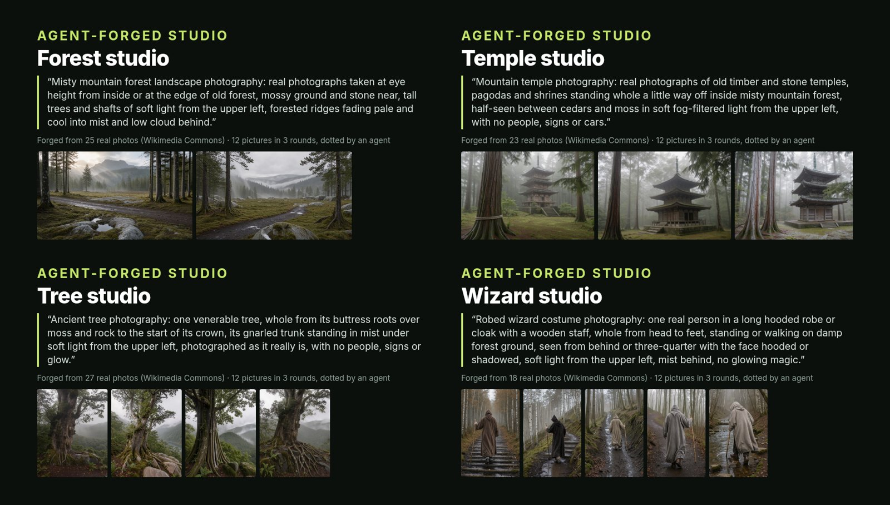
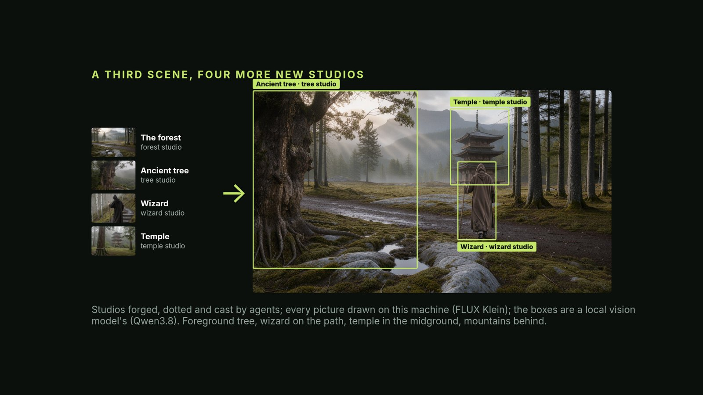

# A tour of what ships

Everything in the repo was already rendered, so this tour needs no key and no network: install Boson
([README](../README.md#install)), open **http://127.0.0.1:8188/boson/app**, and follow along. The first open of a studio or a
scene takes a few seconds: it is cloned from its bundle in `examples/`.

## Four studios, each with its own taste and its own history

Each was forged from reference photos and one sentence, then run through dotted rounds by the author:

Click **Architecture** (or Cars, Fashion, Posters): the studio's house, its rounds, each verdict beside what it
changed and what the next round made.

## The scene editor

A street where every piece is a slot (a box on the picture that can be refilled: an outfit, a car, a poster, a
building) that any studio can fill, with pieces made for that exact spot:

A swap redraws only the slot; the rest of the frame is kept:

Click **Austin stop**: the scene, its takes, which studio filled which slot, and its clips. Click a box on the
picture: its studio, a picker for any other studio, their pieces. With "live calls" off, Make and Swap only replay
what was made (no key); take 08 -> 12 is the outfit, the taqueria made a slot, and a car from a second car studio.

**Graph** (top right) shows the real ComfyUI graph under every screen; every button sets widgets on real nodes.

## Two scenes with no human in any seat

Streets are one case. The same studios and slots make any scene. On 2026-10-29 four agents each gathered real NASA and
Wikimedia Commons photos, forged a studio from them (terrain, rockets, robots, the sky), and ran three rounds, dotting
and judging their own pictures. Then one more agent built the scene and cast its slots. Every picture was drawn on one
RTX 4090 by FLUX 3 Klein, and the boxes were found by Qwen3.8 on the same card:

The agents' dots and verdicts are their own judgments, not the author's taste. The words behind it (each studio's
text, the descriptions of the photos) came from cloud models: Claude and Gemini.

The same afternoon, a second swarm made the opposite world: a mystic forest, all mist, haze and shafts of light, with
a clear foreground, midground and background. Four more agents forged a forest, a temple, an ancient-tree and a wizard
studio from Wikimedia Commons photos, and the scene agent placed the tree in front, the wizard on the path, the temple
in the mist and the mountains behind. Each studio picture was drawn from two of the studio's own open-licence photos
(public domain, CC0 or CC BY; credited in `refs-licences/`) instead of from its green pins, which the local model had
copied:

- Click **Airless landing**: the sci-fi scene, its four slots (rocket, rover, walker, ringed planet) and the four
  agent-forged studios that filled them (terrain, rockets, robots, skybox), each with its three dotted rounds.
- Click **Mystic forest**: the forest scene, its three slots (ancient tree, wizard, temple), its four studios (forest,
  temple, tree, wizard), and take 02, where only the wizard was swapped for one in a black robe.

How to run that loop yourself, with a script or an agent judging: [HEADLESS.md](HEADLESS.md).

## Cloud and local, side by side

One test (2026-10-28): the same Austin scene from the same prompts, drawn three ways: A all cloud (Nano Banana), B
all on this machine (FLUX 3 Klein), C the cloud street with Klein drawing the takes. The author judged A and C equal
on 11 of 12 takes (A better on the other, where C changed the wrong building) and B worse, for its framing, not its
detail. On the 39 pieces: A 18, tie 19, B 2. The shipped Austin scene is A.
